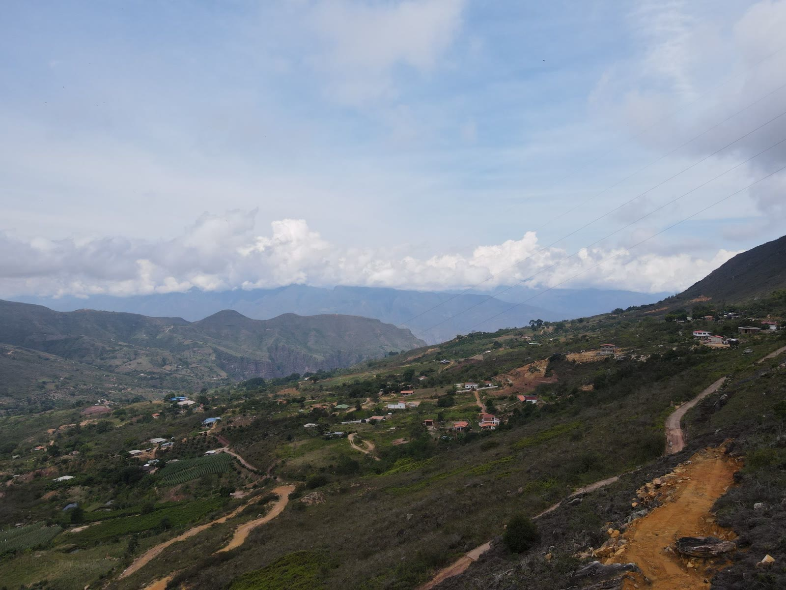
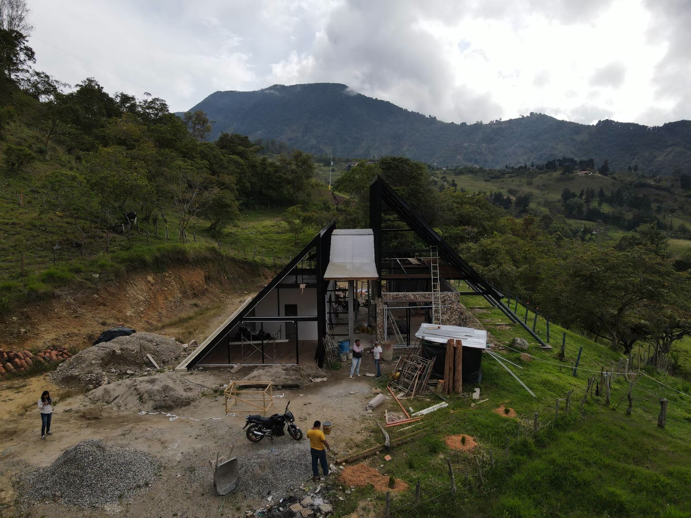
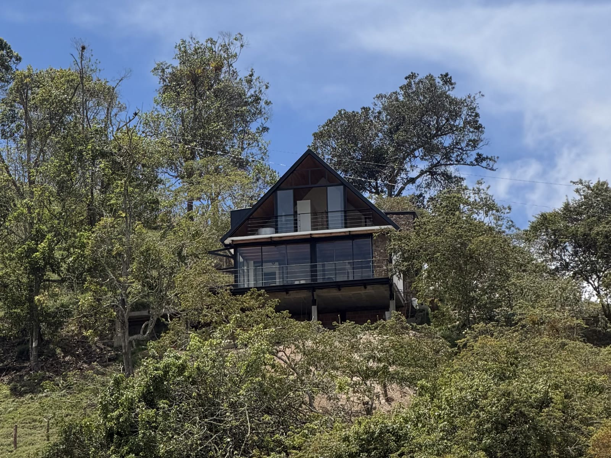

Ves una cabaña de madera con ventanal hacia el cañón, anunciada “lista en 30 días”, y la cuenta parece fácil: compras tu parcela o lote, la instalas y la rentas los fines de semana. Mucha gente que nos visita en la Mesa de los Santos llega con esa idea, y no está mal. Solo le faltan unas piezas.

El precio del catálogo casi nunca es el precio final. Y la Mesa está en una zona sísmica, así que la cabaña tiene que estar diseñada y construida para eso.

En esta guía comparamos las cabañas prefabricadas con las construidas en sitio, te mostramos qué costos no aparecen en la cotización y cómo elegir según lo que buscas. Al final te contamos cómo tener tu cabaña en la Mesa sin encargarte de la parte técnica.

**Contenido**

1. [Por qué tantas personas piensan en una cabaña en la Mesa](#por-qué-tantas-personas-piensan-en-una-cabaña-en-la-mesa)
2. [Cabaña prefabricada o construida: las diferencias](#cabaña-prefabricada-o-construida-las-diferencias)
3. [¿Cuánto cuestan las cabañas prefabricadas?](#cuánto-cuestan-las-cabañas-prefabricadas)
4. [La parte técnica: quién se encarga](#la-parte-técnica-quién-se-encarga)
5. [¿Y el glamping?](#y-el-glamping)
6. [Entonces, ¿cuál te conviene?](#entonces-cuál-te-conviene)
7. [Parcela con vista y cabaña: así funciona en Mirador de la Montaña](#parcela-con-vista-y-cabaña-así-funciona-en-mirador-de-la-montaña)
8. [Preguntas frecuentes](#preguntas-frecuentes-sobre-cabañas-prefabricadas)

## Por qué tantas personas piensan en una cabaña en la Mesa

La Mesa de los Santos pasó de ser un lugar de paso a un destino de fin de semana. En el Festival Turístico de noviembre de 2024 llegaron al menos 38.000 visitantes en un puente festivo, frente a unos 10.000 de un puente normal, y cerca de 300 hoteles de Los Santos y la Mesa reportaron ocupación completa, según la alcaldía y los organizadores ([Vanguardia](https://www.vanguardia.com/area-metropolitana/bucaramanga/2024/11/10/reportan-cifras-positivas-para-la-economia-tras-el-festival-turistico-de-los-santos/)).

Es la cifra de un evento puntual, no de todo el año. Pero muestra que hay demanda en temporadas.

Si todavía estás conociendo la zona, empieza por nuestra [guía de la Mesa de los Santos](/blog/mesa-de-los-santos/): dónde queda, su clima y en qué se diferencian sus sectores.

## Cabaña prefabricada o construida: las diferencias

Una cabaña prefabricada se fabrica por piezas o módulos en una planta y se arma en el lote. Una cabaña construida se levanta en el sitio, con cimentación, estructura y muros hechos ahí. Las dos pueden ser buenas. Lo que cambia es para qué la quieres y cuánto tiempo piensas tenerla. Si tienes prisa y el modelo se adapta a tu lote, la prefabricada puede servirte. Si piensas tenerla muchos años y rentarla, en un terreno con pendiente y vista, conviene más construirla en sitio.

| | Cabaña prefabricada | Cabaña construida en sitio |
| :---- | :---- | :---- |
| Tiempo de armado | Semanas, una vez lista la base | Meses |
| Diseño | Modelos de catálogo, con ajustes limitados | Se diseña para tu terreno: vista, sol, pendiente |
| Confort térmico | Bajo en las más comunes (láminas de concreto de 1,5 cm): se calienta de día y se enfría de noche | Mejor, con muros pensados para el clima de la Mesa |
| Mantenimiento | Mayor si es de madera: barniz cada 4 o 5 años ([Fincaraíz](https://www.fincaraiz.com.co/blog/?p=31311)) | Menor en muros de mampostería o estructura metálica |
| Norma sísmica | Debe cumplir la NSR-10; usualmente este tipo de vivienda no la cumple. | Se diseña directamente bajo la NSR-10 |
| Licencia de construcción | Sí la necesita | Sí la necesita |
| Ampliaciones futuras | Limitadas al sistema del fabricante | Se pueden prever desde el diseño |
| Quién coordina la parte técnica | Tú: fabricante, cálculos, transporte e instalación | El constructor, de principio a fin |

## ¿Cuánto cuestan las cabañas prefabricadas?

El precio de las cabañas prefabricadas depende del sistema (madera, concreto o paneles), del tamaño y del nivel de acabado. Los precios que publican los fabricantes suelen estar calculados para la ciudad, y muchos cotizan solo la estructura.

Lo que pocas veces incluye el precio de catálogo, según lo que vemos en obra:

* **La cimentación o placa** sobre la que se apoya la cabaña ([La República](https://www.larepublica.co/infraestructura/una-construccion-prefabricada-cuesta-20-millones-en-promedio-2886475)).
* **El transporte** hasta el lote, que en vías rurales puede encarecerse.
* **La instalación** y la mano de obra en sitio.
* **Las redes**: agua, energía y manejo de aguas residuales (en zona rural suele requerir pozo séptico o un sistema similar).
* **La licencia de construcción** y los diseños que exige.
* **Terrazas, deck y adecuación del terreno.**

Antes de comparar precios, pide que cada cotización diga por escrito qué incluye y qué no. Dos cabañas con el mismo precio por metro cuadrado pueden terminar costando muy distinto.

## La parte técnica: quién se encarga

Toda cabaña, prefabricada o construida, tiene una parte que no se ve en las fotos: el diseño bajo la norma sismorresistente NSR-10, los permisos y una instalación bien hecha. En la Mesa importa más, porque está sobre el nido sísmico de Bucaramanga ([Blu Radio](https://www.bluradio.com/regiones/santanderes/por-que-tiembla-tanto-en-los-santos-santander-esto-explica-el-servicio-geologico-rg10)).

Con una prefabricada, esa parte suele quedar en tus manos: coordinar al fabricante, a quien firma los cálculos, el transporte y la instalación. Y el equipo que la monta importa tanto como el modelo, porque un detalle mal resuelto puede hacer que los muros se agrieten o que la cabaña se sienta endeble. Generalmente se requiere personal altamente calificado para poder hacer realizar este tipo de viviendas.

Con una cabaña construida en sitio, el constructor responde por todo el proceso, desde el diseño hasta la entrega. Tú defines cómo la quieres. Y para el constructor, conseguir mano de obra es más sencillo, ya que son sistemas más convencionales.

## ¿Más barato construir directamente con un maestro de obra?

Esta es un arma de doble filo, si bien hay personas que se dedican a esto y lo hacen muy bien, usualmente se presentan los mismos desafíos como: descuadres en el presupuesto e incrementos considerables de los costos de una construcción, decisiones arbitrarias en obra: no seguir planos, diseños o incluso buscar ahorrar poniendo materiales de peor calidad, retrasos en las entregas, también la falta de respaldo que tiene una persona vs realizarlo con una empresa, en donde trabaja un equipo especializado en las distintas áreas, arquitectura, presupuesto, ingeniería. Esto resulta de vital importancia si lo que quiere es construir una vivienda duradera, con garantía y si cuentas con poco tiempo o estás fuera del país.

## ¿Y el glamping?

El glamping usa estructuras más ligeras, como domos o tiendas con acabados de hotel, y se arma más rápido que una cabaña. Por eso hay quienes empiezan por ahí para probar la demanda turística.

Si lleva baño, cocina o una base fija, también necesita licencia, como cualquier construcción. Antes de decidir, mira cuánto dura la estructura con el sol, el viento y la lluvia de la Mesa.

## Entonces, ¿cuál te conviene?

* **Una prefabricada**, si tienes prisa, tu terreno es plano y el modelo se adapta a él, y aceptas más mantenimiento y menos aislamiento del calor y del frío.
* **Una cabaña construida en sitio**, si la quieres para muchos años, piensas rentarla y tu terreno tiene pendiente y vista.

En los dos casos, todo empieza por el mismo lugar: el terreno. Y en una cabaña para rentar, el terreno vale por su vista.

## Parcela con vista y cabaña: así funciona en Mirador de la Montaña

En una cabaña para rentar, la vista es lo que más vende: es lo primero que ve el huésped en las fotos y lo que lo hace volver. En la Mesa, las mejores vistas al cañón suelen estar en terrenos con pendiente, justo donde una cabaña construida en sitio funciona mejor. Y la demanda existe: la Mesa se llena en puentes, festivos y temporadas de vacaciones. Una cabaña tiene potencial de renta, aunque nadie puede garantizarte cuánto va a producir.

En [Mirador de la Montaña](/mirador-de-la-montana/), en la zona del Salto del Duende, compras tu parcela campestre sin crédito hipotecario y la pagas a cuotas directamente a Grupo Mizar ([así funciona](/blog/vivienda-sin-cuota-inicial/)) sin intereses por un año. El proyecto ya tiene sus licencias, así que al terminar de pagar escrituras tu parcela a tu nombre.

Y de la cabaña nos encargamos nosotros: la diseñamos orientada hacia el cañón, nos ocupamos de los permisos y la construimos. También la pagas a cuotas, con las condiciones que te explica un asesor. Tú solo te ocupas de pagar tus cuotas y de revisar los acabados.

Llevamos más de 20 años construyendo en Colombia, con más de 100 obras entregadas, y hemos entregado parcelaciones y apartamentos en Piedecuesta, Girón y la propia Mesa de los Santos. [Conoce quiénes somos](/nosotros/).

[**Conoce Mirador de la Montaña →**](/mirador-de-la-montana/)

## Preguntas frecuentes sobre cabañas prefabricadas

**¿Cuánto cuestan las cabañas prefabricadas?**

Depende del sistema, el tamaño y los acabados. El precio de catálogo casi siempre cubre solo la estructura: la cimentación, el transporte, la instalación, las redes y la licencia se pagan aparte.

**¿Vale la pena una casa prefabricada?**

Puede servir si necesitas rapidez y el modelo se adapta a tu terreno. Pero exige personal muy especializado en la instalación, porque un detalle mal resuelto puede agrietar los muros, y las más comunes, de láminas de concreto de 1,5 cm, aíslan poco del calor y del frío. Para una cabaña de muchos años, con vista y en pendiente, construir en sitio funciona mejor.

**¿Una cabaña prefabricada necesita licencia de construcción?**

Sí. Debe tener licencia y cumplir la norma sismorresistente NSR-10, como cualquier construcción.

**¿Puedo construir mi cabaña a cuotas en la Mesa de los Santos?**

Sí, en Mirador de la Montaña. Grupo Mizar diseña tu cabaña, se ocupa de los permisos y la construye, y tú la pagas a cuotas con las condiciones que te explica un asesor.

**Sigue leyendo:** [La Mesa de los Santos: guía para vivir e invertir](/blog/mesa-de-los-santos/) · [Vivienda sin cuota inicial: ¿es posible en Colombia?](/blog/vivienda-sin-cuota-inicial/) · [Promesa de compraventa: qué es y qué revisar](/blog/promesa-de-compraventa/)

*Actualizado: 23 de octubre de 2026. Escrito por el equipo de Grupo Mizar.*
