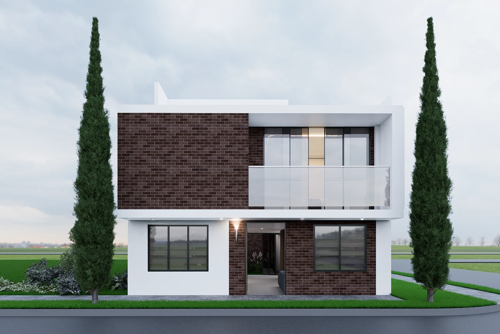

Setenta metros cuadrados parecen poco cuando los miras como terreno vacío. Pero una casa de dos pisos en un lote de 7x10 puede tener tres habitaciones, dos baños, sala, cocina y patio. Y no tienes que construirla toda de una vez.

La mayoría de las familias que compran un lote para dejar de pagar arriendo construyen por etapas: primero un piso para pasarse, y el segundo cuando el bolsillo lo permite. Funciona muy bien, siempre que la primera etapa se haga pensando en la segunda. Eso se decide en el diseño, antes de poner el primer ladrillo.

En esta guía te mostramos el verdadero alcance de un lote de 7x10: desde una casa familiar de tres habitaciones hasta una casa con local en el primer piso. Y te explicamos cómo construirla por etapas y qué debe quedar listo desde el principio.

**Contenido**

1. [Cuánto espacio da un lote de 7x10](#cuánto-espacio-da-un-lote-de-7x10)
2. [¿Cuántas habitaciones caben en una casa de dos pisos de 7x10?](#cuántas-habitaciones-caben-en-una-casa-de-dos-pisos-de-7x10)
3. [Tres diseños de casas de dos pisos en 7x10](#tres-diseños-de-casas-de-dos-pisos-en-7x10)
4. [Cómo construir una casa de dos pisos por etapas](#cómo-construir-una-casa-de-dos-pisos-por-etapas)
5. [Lo que debe quedar listo desde la primera etapa](#lo-que-debe-quedar-listo-desde-la-primera-etapa)
6. [Licencia y norma: lo que debes saber](#licencia-y-norma-lo-que-debes-saber)
7. [Preguntas frecuentes](#preguntas-frecuentes-sobre-casas-de-dos-pisos-en-7x10)

## Cuánto espacio da un lote de 7x10

Un lote de 7x10 tiene 70 m². No todo se puede construir: la norma de cada municipio fija aislamientos, como un patio posterior, que dejan libre una parte del terreno. Por eso el área por piso suele ser algo menor que el lote.

Con dos pisos, el área construida casi se duplica. Por eso las casas de dos pisos son la opción más común en lotes urbanos pequeños: creces hacia arriba, no hacia los lados.

Si tu lote es de 7x16 (112 m²), tienes más margen para un patio grande, un parqueadero o un local al frente.

## ¿Cuántas habitaciones caben en una casa de dos pisos de 7x10?

En la mayoría de los diseños, tres habitaciones, y hasta cuatro si una queda en el primer piso. Esta es una distribución de referencia:

| | Primer piso | Segundo piso |
| :---- | :---- | :---- |
| Zonas | Sala, comedor, cocina, patio de ropas | Tres habitaciones |
| Baños | Un baño social | Uno o dos baños |
| Opcional | Una habitación o un estudio | Un balcón hacia la calle |

La distribución final depende de los aislamientos que exija la norma del municipio, de la ubicación de la escalera y de cuánta luz y ventilación entran por el frente y por el patio.

## Tres diseños de casas de dos pisos en 7x10

**1. La casa familiar de tres habitaciones.** Zona social y cocina abajo, habitaciones arriba. Es la distribución que más se pide en casas de dos pisos porque separa el ruido del día del descanso de la noche.

**2. La casa con local en el primer piso.** Un local al frente para un negocio, y la vivienda completa en el segundo piso, con acceso independiente. Sirve para quien quiere que el primer piso ayude a pagar, siempre dentro de lo que permita la norma del municipio.

**3. La casa que crece.** Un primer piso habitable desde el primer día (sala, cocina, baño y una o dos habitaciones) con la escalera y la estructura listas para el segundo. Es el diseño de quien quiere pasarse pronto y dejar de pagar arriendo.

**¿Quieres ver los diseños completos?** Te los mostramos por videollamada. [Habla con un asesor →](/contacto/)

## Cómo construir una casa de dos pisos por etapas

| Etapa | Qué se hace | Por qué en este orden |
| :---- | :---- | :---- |
| 1. Diseño y licencia | Diseño arquitectónico y estructural de la casa completa, con los dos pisos | La licencia y la estructura se calculan para la casa final, no solo para la primera etapa |
| 2. Cimentación y estructura | Cimientos, vigas y columnas calculados para dos pisos | Es lo más difícil de corregir después |
| 3. Primer piso habitable | Muros, cubierta o placa, redes, baño, cocina y acabados básicos | Te pasas a vivir y dejas de pagar arriendo |
| 4. Segundo piso | Muros, habitaciones, baños y acabados | Lo construyes cuando tu presupuesto lo permite |

La diferencia entre construir por etapas bien y mal está en la etapa 1. Si el diseño solo contempla un piso, subir el segundo puede obligar a reforzar o demoler.

## Lo que debe quedar listo desde la primera etapa

* **La cimentación calculada para dos pisos.** El peso del segundo piso lo cargan los cimientos que haces hoy.
* **Las columnas con el refuerzo en espera**, para continuarlas arriba sin romper.
* **La placa entre pisos**, o al menos la estructura que la va a recibir.
* **La escalera ubicada** en su sitio definitivo, aunque la termines después.
* **Las redes de agua y desagües** previstas para los baños del segundo piso.

Con eso, el segundo piso es una continuación. Sin eso, es una obra nueva sobre una casa que no estaba hecha para cargarla.

## Licencia y norma: lo que debes saber

**La licencia de construcción.** Se tramita ante la curaduría o la oficina de planeación del municipio, según corresponda. Tiene una vigencia de 24 meses, prorrogable una sola vez por 12 meses más ([Ministerio de Vivienda, Decreto 1077 de 2015](https://www.minvivienda.gov.co/sites/default/files/conceptos_juridicos/2020ee0028511.pdf)). Si el segundo piso se construye después de ese plazo, se debe tramitar una nueva licencia, en la modalidad de ampliación.

**La norma sismorresistente.** Las casas de uno y dos pisos tienen un capítulo propio en la NSR-10, el Título E, con reglas para la cimentación, las vigas de amarre y los muros confinados ([NSR-10, Título E](https://www.idrd.gov.co/sites/default/files/documentos/Construcciones/5titulo-e-nsr-100.pdf)). Cumplirlo desde la primera etapa es lo que permite subir el segundo piso con tranquilidad.

## Mi Lote: lotes de 7x10 y 7x16 en San Cayetano

[Mi Lote](/lotes-cucuta/) es el proyecto de Grupo Mizar en San Cayetano, Norte de Santander, cerca al anillo vial que conecta con Cúcuta. Son lotes urbanos de 7x10 y 7x16 metros, con servicios de agua, luz, alcantarillado, pavimentación y andenes.

En Mi Lote, por ejemplo, pagas tu lote a cuotas, sin intereses, sin crédito hipotecario y sin consulta a centrales de riesgo ([así funciona](/blog/vivienda-sin-cuota-inicial/)). Y cuando termines de pagar tu lote, puedes financiar con nosotros la construcción de tu casa, con los planos incluidos, también a cuotas y con las condiciones que te explica un asesor. Detrás del proyecto hay una empresa con más de 20 años y más de 100 obras entregadas en Colombia. [Conoce Grupo Mizar](/nosotros/).

Si estás mirando la zona, en nuestra guía de [San Cayetano, Norte de Santander](/blog/san-cayetano-norte-de-santander/) te contamos cómo llegar y qué está cambiando.

[**Conoce Mi Lote en San Cayetano →**](/lotes-cucuta/)

## Preguntas frecuentes sobre casas de dos pisos en 7x10

**¿Cuántas habitaciones caben en una casa de dos pisos de 7x10?**

En la mayoría de los diseños, tres habitaciones en el segundo piso, y una cuarta en el primero si la necesitas. Depende de los aislamientos que exija la norma del municipio.

**¿Cómo se construye una casa por etapas?**

Primero se diseña la casa completa y se tramita la licencia. Luego se hace la cimentación y la estructura para dos pisos, se termina el primer piso para vivir y el segundo se construye después.

**¿Necesito licencia para construir el segundo piso?**

Sí. Si lo construyes dentro de la vigencia de la licencia original, queda cubierto. Si pasa más tiempo, necesitas una licencia de ampliación.

**¿Puedo tener un local en el primer piso?**

Sí, si el uso del suelo del lote lo permite. El diseño debe prever un acceso independiente a la vivienda.

**¿Puedo pagar la construcción de mi casa a cuotas?**

Sí, en Mi Lote. Primero pagas tu lote a cuotas sin intereses y, cuando terminas de pagarlo, puedes pagar la construcción a cuotas con las condiciones que te explica un asesor.

**Sigue leyendo:** [San Cayetano, Norte de Santander: cómo llegar y qué saber](/blog/san-cayetano-norte-de-santander/) · [Vivienda sin cuota inicial: ¿es posible en Colombia?](/blog/vivienda-sin-cuota-inicial/) · [Promesa de compraventa: qué es y qué revisar](/blog/promesa-de-compraventa/)

*Actualizado: 23 de octubre de 2026. Escrito por el equipo de Grupo Mizar.*
